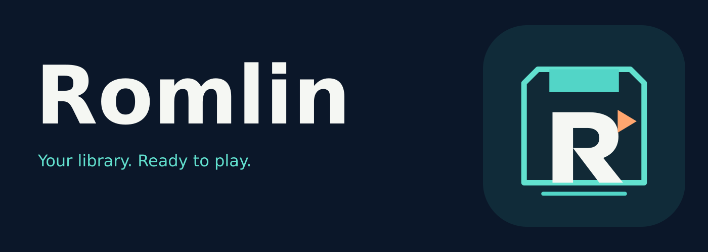

<p align="center">
  <a href="https://romlin-emu.github.io"></a>
</p>

<p align="center">
  <a href="https://github.com/romlin-emu/romlin/releases/latest"></a>
  <a href="https://github.com/romlin-emu/romlin/releases/tag/nightly"></a>
  <a href="https://github.com/romlin-emu/romlin/actions/workflows/ci.yml"></a>
</p>

<p align="center">
  
  <a href="https://romm.app"></a>
  <a href="LICENSE"></a>
</p>

<p align="center">Play retro games from your <a href="https://romm.app">RomM</a> library, with each game running in its own sandboxed process.</p>

<p align="center"><a href="https://romlin-emu.github.io">romlin-emu.github.io</a></p>

Download the [latest release](https://github.com/romlin-emu/romlin/releases/latest) or the [nightly build](https://github.com/romlin-emu/romlin/releases/tag/nightly) for macOS, Windows and Linux. On Linux, pick the AppImage, or the .deb (Debian, Ubuntu) or .rpm (Fedora, openSUSE) to install it with the system's other software. On a Mac you can also install it with [Homebrew](https://brew.sh): `brew install --cask romlin-emu/tap/romlin`. Unsigned macOS builds may require right-clicking Romlin and choosing Open the first time. Windows builds aren't signed yet: the first time, choose More info, then Run anyway.

<p align="center"><em>Screenshots below show the upstream RomP interface from which Romlin is derived.</em></p>

<p align="center">
  
</p>

| Game page | Playing | Nintendo DS |
|---|---|---|
|  |  |  |

## Features

- **Your RomM library:** platforms, favorites, collections, recently played, now playing and backlog, with search, sorting, a Surprise me button for a random game, and box art shaped like each console's.
- **One click to play:** Romlin installs the right emulator and BIOS files. Downloaded games play offline.
- **Saves that follow you:** in-game saves and save states sync with RomM before and after you play. If both sides changed, you choose which to keep.
- **Sandboxed emulators:** emulators are native code downloaded from the internet, and games are files from anywhere. Each game runs in its own locked-down process that can only write to that game's saves and its own temporary files, so a buggy or malicious emulator or ROM can't touch your other files or take Romlin down with it. xemu, RPCS3 and Eden run outside the sandbox.
- **RetroAchievements:** earn achievements as you play, with popups, leaderboards, and an achievement list in the game menu and on each game's page. Hardcore mode comes once RetroAchievements approves Romlin, which it considers after an emulator has been public for six months. Only the app talks to RetroAchievements, never the sandboxed emulator.
- **Many systems:** from the Atari 2600 to the PS3 and original Xbox, plus arcade and home computers. See [supported systems](#supported-systems).
- **Controllers and multiplayer:** gamepads join as the next player, rumble when the game does, any key or button can be remapped, and the whole app works with a controller.
- **Light guns, mice and keyboards:** for the systems that use them.
- **In-game menu:** pause, restart, save slots, changing discs, volume and full screen, from the Guide button or Esc.
- **Two-screen Nintendo DS:** a window per screen, with the mouse as the touch pen.
- **Picks up where you left off:** the last console, game and scroll position, and the size and position of every window.
- **Interface sizes:** 1x, 1.5x or 2x.

## Supported systems

Romlin downloads the emulator for each system the first time you play one of its games.

| System | Emulator |
|---|---|
| Arcade, including Neo Geo and CPS 1–3 | FinalBurn Neo |
| Amstrad CPC | Caprice32 |
| Atari 2600 | Stella |
| Atari 5200 | a5200 |
| Atari 7800 | ProSystem |
| Atari 8-bit computers and XEGS | Atari800 |
| Atari Jaguar and Jaguar CD | Virtual Jaguar |
| Atari Lynx | Beetle Lynx |
| Atari ST | Hatari |
| Bandai WonderSwan and WonderSwan Color | Beetle WonderSwan |
| ColecoVision | Gearcoleco |
| Commodore 64 | VICE x64sc |
| Commodore 128 | VICE x128 |
| Commodore VIC-20 | VICE xvic |
| Commodore Plus/4 and 16 | VICE xplus4 |
| Commodore Amiga, Amiga CD32 and CDTV | PUAE |
| DOS | DOSBox Pure |
| Fairchild Channel F | FreeChaF |
| Intellivision | FreeIntv |
| Magnavox Odyssey 2 | O2EM |
| Mega Duck / Cougar Boy | SameDuck |
| MSX, MSX2 and MSX2+ | blueMSX |
| NEC PC Engine / TurboGrafx-16 | Beetle PCE Fast |
| NEC PC Engine CD / TurboGrafx-CD | Beetle PCE |
| NEC SuperGrafx | Beetle SuperGrafx |
| NEC PC-FX | Beetle PC-FX |
| Nintendo Entertainment System, Famicom and Famicom Disk System | Nestopia UE |
| Super Nintendo and Super Famicom | Snes9x |
| Nintendo 64 | Mupen64Plus-Next |
| Game Boy, Game Boy Color and Game Boy Advance | mGBA |
| Nintendo DS | melonDS DS |
| Nintendo GameCube and Wii | Dolphin |
| Nintendo Virtual Boy | Beetle VB |
| Nintendo Game & Watch | Game & Watch |
| Nintendo Pokémon Mini | PokeMini |
| Philips CD-i | SAME CDi |
| 3DO | Opera |
| Sega Master System, Genesis / Mega Drive, Game Gear, Sega CD and SG-1000 | Genesis Plus GX |
| Sega 32X | PicoDrive |
| Sega Saturn | Beetle Saturn |
| Sega Dreamcast | Flycast |
| SNK Neo Geo CD | NeoCD |
| SNK Neo Geo Pocket and Pocket Color | Beetle NeoPop |
| Sony PlayStation | Beetle PSX HW |
| Sony PlayStation 2 | PCSX2 on Windows and Linux, [ARMSX2](https://github.com/romlin-emu/ARMSX2) on macOS |
| Sony PlayStation 3 | RPCS3 |
| Sony PSP | PPSSPP |
| PICO-8 | [FAKE-08](https://github.com/romlin-emu/fake-08) |
| TIC-80 | TIC-80 |
| Vectrex | Vecx |
| Watara Supervision | Potator |
| Microsoft Xbox | xemu |
| Nintendo Switch (Linux and Windows, x86-64/ARM64) | Eden |
| ZX Spectrum | Fuse |

All emulators except xemu, RPCS3 and Eden are [libretro](https://www.libretro.com) cores. Romlin downloads PCSX2 and ARMSX2 from its own PS2 core builds, which add per-game texture loading. FAKE-08 comes from Romlin's own fork. Dolphin, PPSSPP, Flycast, Beetle PSX HW, Mupen64Plus-Next and the PS2 emulators draw through Vulkan when the computer has a working Vulkan driver, and through OpenGL otherwise. On macOS, Vulkan comes from the bundled [MoltenVK](https://github.com/KhronosGroup/MoltenVK). Some systems need BIOS files, which Romlin takes from your RomM server's firmware. PS3 games need the PS3 system software (`PS3UPDAT.PUP`) in RomM's PS3 firmware, and play from a game folder or an ISO, or a zip or 7z of one.

## SteamOS and Steam Deck

The Linux AppImage is the portable option for SteamOS; it does not need a system
package install. Builds containing Gaming Mode detection automatically open both
the library and games fullscreen in a Gamescope desktop session, without changing
your saved desktop preferences. Desktop Mode keeps its usual window behavior.

The quickest setup needs no terminal or external keyboard:

1. Switch to **Desktop Mode** and open this page in the browser.
2. Download [Install Romlin](https://raw.githubusercontent.com/romlin-emu/romlin/main/packaging/steamos/Install-Romlin.desktop).
   Open the downloaded file in Dolphin and approve **Execute** (or **Trust and
   Launch**) if asked. If needed, enable **Is executable** in its Properties.
3. Follow the installer prompts and exit Steam using **Steam → Exit** when
   asked. The installer reuses an existing Romlin shortcut. If none exists, choose
   **Yes** to add it, confirm in Steam, then exit Steam again when prompted
   so the installer can apply the library artwork.
4. Return to Gaming Mode and open **Library → Non-Steam → Romlin**. Connect to
   your RomM server; **Steam + X** opens the on-screen keyboard.

The installer downloads the latest nightly x86_64 AppImage from
[romlin-emu/romlin](https://github.com/romlin-emu/romlin/releases/tag/nightly), which
includes the SteamOS scaling and controller navigation fixes, and verifies its
release SHA-512 checksum. It uses `~/Applications/Romlin/Romlin.AppImage` and adds a
Romlin application-menu entry. It needs internet access, Python 3, `kdialog`, and
SteamOS's `steamos-add-to-steam` helper, supplied by SteamOS. No sudo or changes
to the system partition are needed. It runs the AppImage with
`--appimage-extract-and-run`, so FUSE is not required. Run the installer again to
update; close Romlin first. It detects the saved shortcut and refreshes its artwork
without adding another entry.
Steam does not update this installation automatically. The installer also adds portrait
and landscape capsules, a hero banner, a transparent logo and the Romlin icon to
the saved shortcut in each matching Steam profile. This replaces existing artwork
for that shortcut. Artwork is downloaded from this repository; restart Steam to see it.

For a manual install, download the x86_64 AppImage from the
[nightly build](https://github.com/romlin-emu/romlin/releases/tag/nightly), keep it in a
permanent folder under your home directory, and allow execution in Properties.
In Steam, choose **Add a Game → Add a Non-Steam Game** and browse to the AppImage
(show all files if needed). Leave forced Proton compatibility disabled. Select
a gamepad controller layout in Steam Input, then launch Romlin in Gaming Mode.

Automatic detection also works with local games launched using `--core` and
`--rom`, and requests fullscreen from xemu and RPCS3. The existing in-game
fullscreen control still works. Steam may reserve the Guide button: use Esc
(for example, mapped to
a rear button in Steam Input) to open Romlin's game menu. Steam's on-screen keyboard
is available with Steam + X for text entry.

If an AppImage fails to mount, try `--appimage-extract-and-run` in
the shortcut's Launch Options. Keep the AppImage in a user-writable folder and
leave SteamOS's system partition alone.

SteamOS hardware validation is still required, especially for Steam Input,
audio, suspend/resume, switching between the library and emulator windows, and
Nintendo DS's separate screen windows. This is not a Steam Deck Verified claim.

## Running

Requires [rustup](https://rustup.rs) and CMake.

```sh
cargo build --release
./target/release/romlin
```

`make dist` packages the app into `dist/`: `Romlin.app` and a zip on macOS, a zip on Windows, an AppImage, a .deb, an .rpm and a tarball on Linux (Make downloads a pinned [appimagetool](https://github.com/AppImage/appimagetool) and [nfpm](https://nfpm.goreleaser.com) and checks them). On Windows, run it from Git Bash with Make and 7-Zip installed.

`make check` runs the same checks as CI: formatting, Clippy, tests, [cargo-deny](https://github.com/EmbarkStudios/cargo-deny), [cargo-machete](https://github.com/bnjbvr/cargo-machete), [typos](https://github.com/crate-ci/typos), [actionlint](https://github.com/rhysd/actionlint), [zizmor](https://github.com/zizmorcore/zizmor), and the offline release preview. See [release checks and dependency setup](docs/releasing.md#local-checks) for the required Python, Node and release-please installation. The same guide covers stable release PRs and recovery.

[Controller testing](docs/controller-testing.md) covers automated SDL input tests on all three platforms and opt-in Windows device tests using hidmaestro-rs.

`romlin --core <core library> --rom <file>` plays a file without a RomM server, which helps when testing. `ROMLIN_PLATFORM=snes` (or any RomM platform name) gives it that console's look. With `--smoke <folder>` it plays briefly as a check, saving a frame there, and exits with an error if the game doesn't play; the Smoke test workflow runs this on each packaged build before a release.

`make update-rcheevos` replaces the bundled [rcheevos](https://github.com/RetroAchievements/rcheevos) with its latest release, or a given one with `RCHEEVOS=v12.5.0`.

Enter your RomM server address (RomM 5.0 or newer). Approve Romlin in RomM by scanning the code or opening the link.

Open a game from your library to download and play it. Romlin installs the emulator core it needs, and fetches BIOS files from your server's firmware. Downloaded games stay playable when the server is offline.

For PS2 games using PCSX2 or ARMSX2, choose **Install texture ZIP…** on the game's page. Select a ZIP containing PNG or DDS replacement textures, either directly or inside a single `<serial>/replacements/` folder. Romlin installs the pack for that game and loads it automatically on the next launch. Choose **Replace texture ZIP…** to install a different pack. Texture replacement requires the Vulkan or OpenGL hardware renderer; Software and paraLLEl-GS do not apply replacement packs. Use a pack made for your game's region and revision; Romlin does not verify texture hashes against the game. Packs stay local and are not synced through RomM. The first launch with a pack needs internet access to install a core with texture support.


In-game saves and save states sync with RomM before and after you play, so you can continue on another device. If a save changed in both places, Romlin asks which to keep and backs up the other.

## Controls

- Gamepads are picked up automatically: the first one joins the keyboard as player 1, and each new one becomes the next player.
- Change players or remap any key or button in **Settings → Players**.
- The Guide button, or Select and Start together, opens the game menu.
- In Amiga, DOS, C64 and ZX Spectrum games the keyboard types into the game and F12 opens the menu. Click in the game to use your mouse; F12 releases it.
- Accessories such as the SNES Mouse, Super Scope, Zapper or GunCon are chosen per port in the game menu. A light gun aims where you point and fires with the left button; the right button reloads.

Default keyboard layout:

| Key | Action |
|---|---|
| Arrow keys | D-pad |
| X, Z, S, A | A, B, X, Y |
| Q, W, D, F | L, R, L2, R2 |
| Enter, Backspace | Start, Select |
| F5, F7 | Save, load state |
| F6 | Next save slot |
| P | Pause |
| F11 | Full screen |
| F12 | Screenshot |
| Esc | Game menu |

Every key except Esc can be changed in Settings → Players, and shortcuts can be combinations such as Ctrl+S.

Your games, saves and library cache are stored in `~/Library/Application Support/Romlin` on macOS, `%LOCALAPPDATA%\Romlin` on Windows and `~/.local/share/Romlin` on Linux. Romlin adopts the previous `Romp` or `Cartridge` data folder on first launch when no Romlin folder exists. The old `ROMP_DATA_DIR` override and credential-store identifiers remain supported so existing custom profiles and sign-ins carry over. Its `logs` folder holds a log of each of the last five launches; About Romlin → Show log opens it.

## Free, with no catches

Romlin is free and always will be: no paid features, subscriptions, ads, tracking or accounts of its own. Every build has every feature. [PRIVACY.md](PRIVACY.md) lists what Romlin sends and where, and the Licenses tab under About Romlin lists every emulator it downloads with its license.

The interface is English only.

## License

Romlin is free software: you can redistribute it and/or modify it under the terms of the [GNU General Public License](LICENSE), version 3 or (at your option) any later version.

### Nintendo Switch (Eden)

Romlin installs checksum-pinned Eden v0.2.1 on Linux and Windows (x86-64 or ARM64).
Add your own `prod.keys`, optional `title.keys`, and a firmware dump named
`firmware.zip` or a single versioned dump such as `Firmware.18.0.1.zip` to the
Switch platform's firmware in RomM. The zip must contain
`.nca` files (a containing folder is fine). Romlin downloads and installs these before
launching the game. Use firmware and keys dumped from your own console; none are bundled.
Games should be uncompressed `.nsp`, `.xci`, or `.nro` files supported by Eden.

Eden runs outside Romlin's sandbox. Its stable `cores/eden/user` folder (`cores/eden/runtime/user` on Windows)
holds firmware, keys and settings, separately from other Eden installations and
outside version directories. Existing portable data migrates automatically; conflicting
files remain in `cores/eden/legacy-users/<version>` for recovery. Linux extracts the
verified AppImage once and runs it without FUSE.
Each game gets its own NAND in its Romlin save folder. Saves and user profiles sync
to RomM as an Eden ZIP before playing and after closing Eden, using the same conflict
choices and backups as other saves. Offline changes sync when the server returns.
A local working copy is still needed for playing. Firmware and keys are never uploaded.
Save archives are limited to 1 GiB; SD-card/homebrew saves and save states are not synced.

Old saves in the shared portable `user/nand` folder are preserved, not automatically
assigned to games. To import one, close Eden and copy only that title's save directory
into the game's `eden-nand/user/save/...` directory, preserving its account/title path.
The old user profiles are copied automatically when the game's NAND is first created.
Romlin configures up to eight gamepads as Pro Controllers in docked mode. The pad
used most recently in Romlin becomes Player 1; other pads keep their connection
order. Steam's virtual gamepad takes precedence over the physical Deck pad it
shadows. Connect controllers before launching and use a gamepad layout in Steam
Input. Romlin replaces controller types, bindings and input profiles on every
launch and disconnects unused slots. Missing controllers or mappings produce a
notice. Romlin releases its controller handles while external emulators run and
reopens them afterwards. Its fullscreen preference also follows Gaming Mode.
macOS installation is not supported yet.

Pokémon: Let's Go, Pikachu! and Eevee! require Handheld or a single Joy-Con rather
than a Pro Controller. After launching, stop emulation in Eden and open
**Emulation → Configure → Controls** to choose Handheld and your actual input
device (usually **Steam Virtual Gamepad** with Steam Input), then start the game
from Eden. For co-op, configure single Joy-Cons and the required motion inputs.
These manual control settings are replaced on the next launch from Romlin.

## Attribution

Romlin is a fork of [RomP](https://github.com/RompEmu/RomP), originally created by Beshr Kayali Reinholdsson. The upstream authors, contributors, copyright notices and licenses are preserved.
